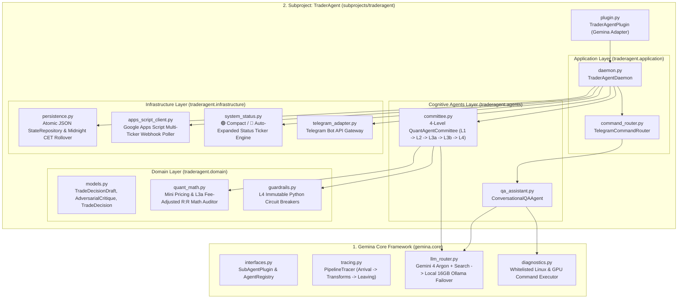

# Gemina & TraderAgent Software Architecture

## 1. Architectural Pattern: Clean / Hexagonal Architecture + Agentic Core

To ensure `gemina` scales cleanly across multiple personal agents while keeping `traderagent`'s trading rules 100% deterministic and testable, the system is divided into **five strict software layers**:

---

## 2. The 4-Level Focused Agentic Quant Loop

Rather than relying on a single-pass LLM prompt where news extraction, thesis generation, fee math, and self-critique compete in one forward pass, `QuantAgentCommittee` ([committee.py](../subprojects/traderagent/traderagent/agents/committee.py)) executes a 4-level pipeline on every 15m bar:

1. **Level 1 (`L1_CATALYST_AGENT`)**: Uses `gemini-4-argon` with Google Search grounding to classify live breaking news sentiment (`BULLISH`, `NEUTRAL`, `BEARISH_HEADWIND`, `BINARY_EVENT_RISK`) and fetch live `USD/SEK`.
2. **Level 2 (`L2_ALPHA_PROPOSER`)**: Evaluates 15m price microstructure (`close` vs `ema4`, `vwap`, `or_high/low`, `pd_low`, `atr14`, `rsi14`) and the last 4 bars of trajectory history to propose a `TradeDecisionDraft`.
3. **Level 3a (`L3A_PYTHON_MATH_AUDITOR`)**: Deterministic Python math service ([quant_math.py](../subprojects/traderagent/traderagent/domain/quant_math.py)) that recomputes the exact fee-adjusted Net Risk/Reward (deducting Avanza's `0.50%` USD FX round-trip fee or `0.38%` Mini spread) and flags any LLM math discrepancy `> 0.35`.
4. **Level 3b (`L3_ADVERSARIAL_CRITIC_LOOP`)**: Adversarial Red-Team Critic agent that audits Level 2's proposal against Level 1's catalyst report and Level 3a's verified math, outputting a calibrated `confidence_score` (`0-100`), `verdict` (`APPROVED`, `REVISED_BY_CRITIC`, `VETOED_BY_CRITIC`), and refined decision.
5. **Level 4 (`L4_HARD_PYTHON_GUARDRAILS`)**: Deterministic Python policy engine ([guardrails.py](../subprojects/traderagent/traderagent/domain/guardrails.py)) enforcing all 7 immutable rules from `risk_profile.json` (`max_daily_trades`, `daily_loss_lockout_sek`, `cooldown_minutes_after_stopout`, `15:30-15:45 CET` US open blackout, `20:30 CET` Nordic ETP cutoff, sub-VWAP gate with `pd_low` sweep exception, structural stop floor below `pd_low`, and auto-exit on `EMA4` failure).

---

## 3. End-to-End Pipeline Observability (`PipelineTracer`)

Every inbound webhook bar and Telegram message is assigned a unique correlation `trace_id` and logged stage-by-stage from `INGEST_ARRIVAL` $\rightarrow$ transformations $\rightarrow$ `EGRESS_LEAVING` into `data/pipeline_trace.jsonl`. Use `traderagent-trace` (or `/trace` on Telegram) to inspect the waterfall.
